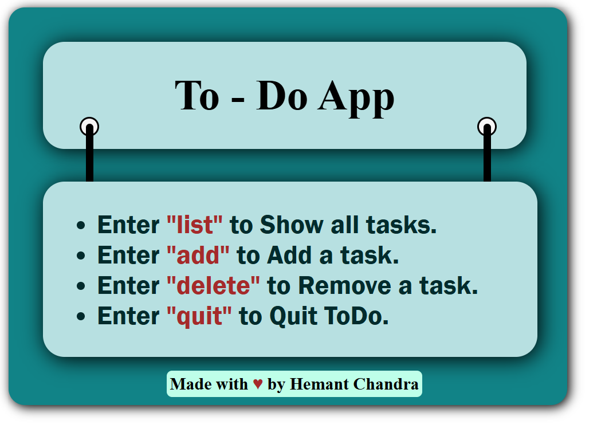

# ✅ To-Do App

A simple To-Do application built with **HTML, CSS, and JavaScript**, created as a hands-on project to practice frontend development and JavaScript fundamentals.

## 📸 Project Preview



## 📌 About the Project

This project is a basic To-Do application with a custom-designed web interface. Its task-management functionality is operated through the browser's JavaScript Console rather than through on-page input fields and buttons.

The project helped me practice JavaScript logic, browser-based execution, and the integration of HTML, CSS, and JavaScript.

## ✨ Features

- Custom-styled To-Do App interface
- List existing tasks
- Add new tasks
- Delete tasks
- Quit the To-Do command workflow
- Browser-based JavaScript interaction

## 🛠️ Technologies Used

- **HTML5** — Page structure
- **CSS3** — Visual design and styling
- **JavaScript** — Task-management logic
- **Browser Developer Tools** — Console-based interaction

## 🧑‍💻 Available Commands

The interface describes these supported commands:

| Command | Purpose |
|---|---|
| `list` | Show all tasks |
| `add` | Add a task |
| `delete` | Remove a task |
| `quit` | Quit the To-Do workflow |

## 🚀 How to Run

1. Clone the repository:

   ```bash
   git clone https://github.com/hemant-chandra/Todo-app.git
   ```

2. Open the project folder:

   ```bash
   cd Todo-app
   ```

3. Open `index.html` in a web browser.

4. Open the browser Developer Tools using `F12` or `Ctrl + Shift + J` in Chrome.

5. Select the **Console** tab and follow the command workflow implemented in `app.js`.

**Note:** This project uses console-based interaction. It does not currently provide a conventional on-page task input form.

## 📚 What I Learned

- Structuring a webpage using HTML
- Styling a custom interface with CSS
- Writing JavaScript task-management logic
- Working with the browser Developer Console
- Organizing and hosting a frontend project with GitHub

## 🔮 Future Improvements

- Add an on-page input field to create tasks
- Add interactive buttons for adding and deleting tasks
- Save tasks using browser local storage
- Improve accessibility and responsive design

## 👨‍💻 Author

**Hemant Chand**

GitHub: [hemant-chandra](https://github.com/hemant-chandra)

---

*An ongoing practice project built to strengthen my frontend development skills.*
